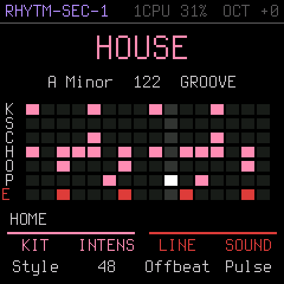
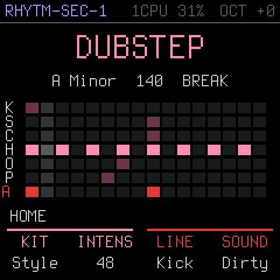
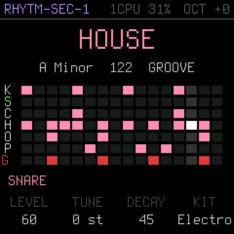
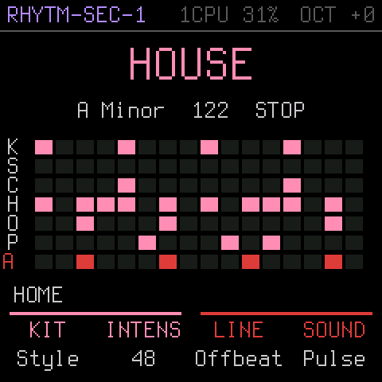
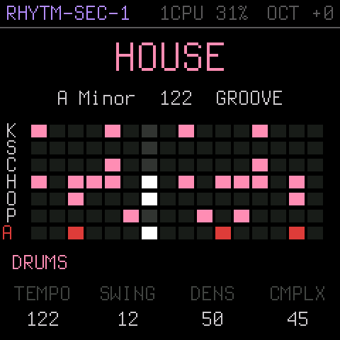
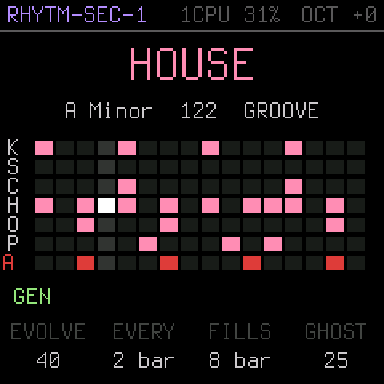
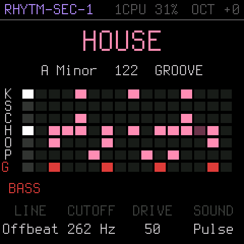
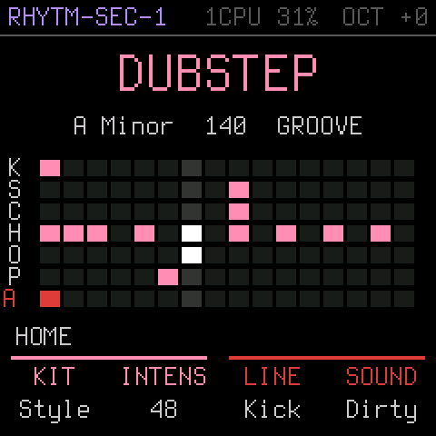
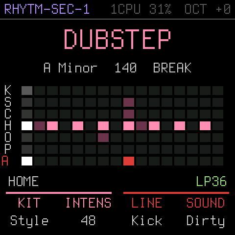

# RHYTM-SEC-1

Standalone firmware for the M-VAVE FM-1 that turns it into a generative drum machine and bass synth.

It uses the drums and bass from deamonSLINKY's [PERF-1](https://github.com/deamonSLINKY/PERF-1). Patterns are drawn from each genre's hit probabilities instead of fixed presets, so they keep evolving while you play. It's built for working up ideas rather than full songs.

<p>



</p>

- 19 styles, with density, complexity and evolve controls
- Bass that follows a root note and scale, with chord moves
- Sections, fills, breaks and builds, all shown on the screen grid
- Per-drum level, tune (in semitones), decay and kit
- A DJ-style low/high-pass filter
- MIDI clock sync over USB, including the DAW's song position
- USB audio with stems: a stereo master plus mono bass, kick, snare + clap, and hats + perc, always at full level whatever the MASTER knob is set to

The full control reference is in [the cheat sheet](https://hamperj.github.io/rhytm-sec-1/cheatsheet.html).

## Install

Every [release](../../releases/latest) has two files. Pick one:

| File | What it is |
|---|---|
| `rhytm-sec-1-X.Y.fwsc` | **Standalone firmware.** The FM-1 runs RHYTM-SEC-1 and nothing else. |
| `rhytmsec1.dock` | **fm1-dock module.** For people already running [fm1-dock](https://github.com/joakimeriksson/fm1-dock) who want RHYTM-SEC-1 alongside their other synths. |

### Standalone firmware

1. Download `rhytm-sec-1-X.Y.fwsc` from the latest release.
2. Install it with your FM-1 firmware flash tool.

The FM-1 starts straight into RHYTM-SEC-1. To go back to another firmware, flash that firmware the same way.

The firmware identifies itself as `FM-1_947` to installers.

**Under the hood:** the firmware is built on [fm1-dock](https://github.com/joakimeriksson/fm1-dock)'s platform as a single-app build, with RHYTM-SEC-1 built in. You don't need fm1-dock or its web page to use it. Two fm1-dock features are still there:
- Holding **HOME** for 1.5 s opens a small menu with the master EQ and MIDI options. There's also a test sine. Pick RHYTM-SEC-1 there to go back.
- Holding **OCT+** at power-on starts in safe mode with the test sine only.

Bluetooth MIDI is left out of this build to make room for the module.

### fm1-dock module

1. Download `rhytmsec1.dock` from the latest release.
2. Add it from fm1-dock's module page, like any other module.

On stock fm1-dock, two things differ from the standalone firmware:
- USB audio is plain stereo and follows MASTER.
- A DAW's Continue restarts from the top instead of the song position.

If you used the earlier PEEP-1 build, remove it from the module list first.

## Controls

A quick overview. For the full detail, including every style, scale, bass line, bass sound and kit, see the [cheat sheet](https://hamperj.github.io/rhytm-sec-1/cheatsheet.html).

**Transport and arrangement**

| Control | Does |
|---|---|
| PLAY | Start / stop. With a DAW playing, joins it in step. |
| SAVE | Breakdown on the next bar. Press again for a build, and again for the drop. |
| FX | A fill on the next bar |
| SEQ | Chords move with the style (lit), or HOLD on the home chord |
| OCT− / OCT+ | Bass down / up an octave (±2) |
| HOME | The HOME page (below) |
| HOME (hold 1.5 s) | Settings menu: EQ and MIDI. On fm1-dock, the module list. |

**Pattern**

| Control | Does |
|---|---|
| GLO | A whole new pattern from the next bar |
| REC | LOCK: the pattern stops evolving |
| Keys C4–F4 | A new pattern for one drum (kick, snare, clap, hat, open hat, perc) |
| Keys F3–B3 | Mute / unmute kick, snare, clap, hat, open hat, perc, bass |

**Encoders**

| Control | Does | With SEL held |
|---|---|---|
| SELECT | Style (changes at once, and resets tempo, density, complexity and sounds) | Tempo, 60–200 BPM |
| PRESETS | Root note | Scale |
| ALGORITHM | DJ filter: left is low-pass, right is high-pass, middle is off | Output: right is SPLIT (drums left, bass right), left is stereo |

**Knob pages** (tap SEL to cycle, or HOME for the HOME page; K1–K4 change the page shown at the bottom of the screen)

| Page | K1 | K2 | K3 | K4 |
|---|---|---|---|---|
| HOME | Kit: all the drums at once, or Style for the style's own mix | Intensity: density and complexity together | Line | Sound |
| DRUMS | Tempo | Swing | Density | Complexity |
| GEN | Evolve | Every (1–16 bars) | Fills | Ghost notes |
| BASS | Line | Cutoff (Hz) | Drive (0 clean, 50 as designed, 100 distorted) | Sound |
| SOUND | Level | Tune (±24 semitones) | Decay | Kit |

On the SOUND page, press keys C4–F4 to pick which drum to edit.

**Screen**
- **Grid:** bright for steps that play, dim for steps that drop out (in a break or build), white for the current step.
- **Bass row:** labelled with the current chord's root.
- **Status line:** EXT plus a tempo when following a DAW's clock, BREAK / BUILD for the section, LP / HP for the filter, SPLIT, the bass octave, HOLD and LOCK.

Over USB MIDI the module follows a DAW's clock: Start, Stop and Continue from a song position.

Settings and the current pattern are saved after it has been stopped and left alone for 10 seconds.

## Screens

| | |
|---|---|
|  |  |
| Stopped: style, key, tempo, the pattern and the HOME page | Playing: steps that play light up, the white column is the current step |
|  |  |
| Tap SEL for the drums page: tempo, swing, density, complexity | The generator page: evolve, how often, fills, ghosts |
|  | |
| The bass page: line, cutoff, drive, sound | |
|  |  |
| The sound page: press a drum's key to pick it (here the snare) | A new style changes at once |
|  |  |
| A break: the steps that drop out are dimmed | The DJ filter (LP36 at top right) during a fill |

The screens are drawn by the module's own code on a computer, through fm1-dock's text and graphics code (`tools/shots.sh`). The top line is the one the firmware shows; its CPU figure here is a placeholder.

## USB audio channels (standalone firmware)

| Input | Signal |
|---|---|
| 1–2 | Master (stereo) |
| 3 | Bass |
| 4 | Kick |
| 5 | Snare + clap |
| 6 | Hats + perc |

The stems are mono and follow mutes and the DJ filter. On Windows, a DAW needs WASAPI, FlexASIO or ASIO4ALL to see all six channels.

## Build from source

You need what fm1-dock's build needs:
- Docker on macOS
- the JieLi toolchain (`fm1-dock/tools/get_toolchain.sh`)
- the AC79 SDK (see fm1-dock's README)

```bash
git clone --recursive https://github.com/hamperj/rhytm-sec-1 && cd rhytm-sec-1
./build.sh                      # -> build/rhytm-sec-1-1.1.fwsc and build/rhytmsec1.dock (VERSION=X.Y for another number)
```

How the build works:
- `fm1-dock/` is a submodule pinned to fm1-dock 0.7.1 (commit 3ec04e5).
- `build.sh` applies `patches/fm1-dock-host.patch`, copies `rhytmsec1/` into fm1-dock's modules, and builds fm1-dock as a solo app with that one module.
- One build gives both release files: the standalone `.fwsc` and the fm1-dock `.dock`.
- `tools/release.sh X.Y` builds both and publishes a GitHub release with both attached.

The patch holds every change to fm1-dock itself:
- the UC25HQ80 flash chip ID, for newer FM-1s
- the stems interface for modules (`hb_host_t.stem`)
- the USB audio layout and the song position forwarding
- the `--uac-stems` and `--uac-full` build options
- a fix to `tools/hbmod.py` for modules with no RAM code

### Engine tests (on your computer)

These run every genre and check evolve, breaks, the filter, stems and the MIDI clock:

```bash
cc -O2 -ffp-contract=off -Irhytmsec1/perf rhytmsec1/perf/test_engine.c -o build/rhytmsec1_test
build/rhytmsec1_test /tmp/rhytmsec1-wavs
```

### Screenshots

`tools/shots.sh` renders `docs/screens/` (needs Pillow).

### Regenerating the style data

`rhytmsec1/perf/styles.h` is generated from PERF-1 (commit 848b3c6) by `gen/dump.c`. Run it with PERF-1 checked out next to this repo as `perf1`:

```bash
cd gen
clang -O0 -w -DEN_HOST -I../perf1/firmware/src/dsp -I../perf1/firmware/src dump.c -o dump -Wl,-undefined,dynamic_lookup
./dump > ../rhytmsec1/perf/styles.h
```

## Status

**Tested on real hardware:** both the standalone firmware and the fm1-dock module, on an FM-1 with the newer UC25HQ80 flash chip. The engine also has its own tests that run on a computer (see Build from source).

## Licence

GPL-3.0-only, as are PERF-1 and fm1-dock. See [LICENSING.md](LICENSING.md) for where each part comes from.

"M-VAVE" and "FM-1" are trademarks of their owners. This project isn't affiliated with or endorsed by them.
